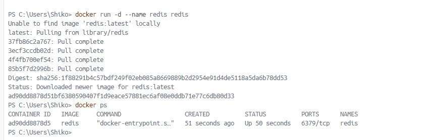
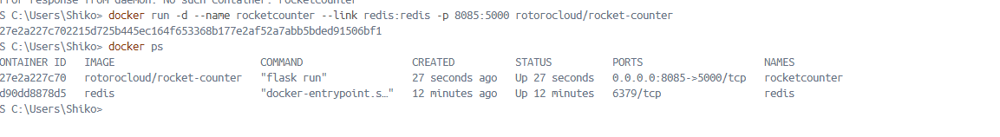
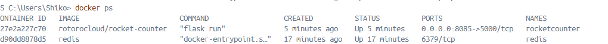
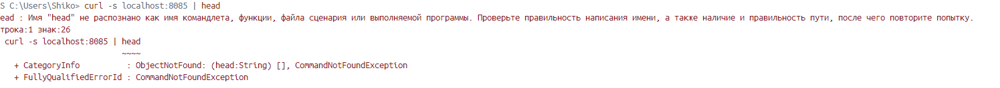
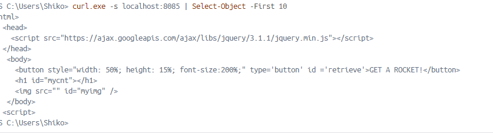
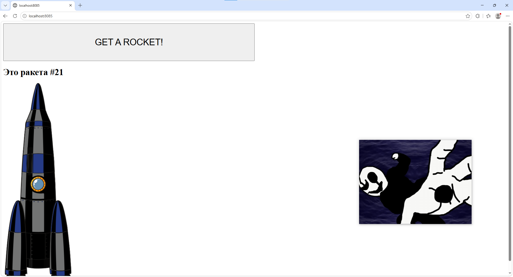
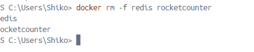

# Лабораторная работа 3: Redis + Rocket Counter + Docker-compose.yml

## Часть 1. Запуск вручную (`docker run`)

Запустили контейнер с редисом в фоновом режиме, проверили его наличие.

Создали контейнер из образа `rotorocloud/rocket-counter` (Конечно же с первого раза). Через `link` связали с контейнером `redis` на 8085 порте хоста (в контейнере порт 5000).

Проверили запуск. Для проверки возвращения счетчика со страницы используем `curl`. 

*(В виндовсе нет `head`, он из линукса, так что выводим через `Select-Object –First 10`, ну либо меняем терминал на линуксовский).*

Счетчик на странице растет.

Удаляем оба контейнера. Линк — старый, не нужен.

---

## Часть 2. Описание стека в `docker-compose.yml`

Создаем каталог `rocketcounter`, переходим в него.

Создаем `docker-compose` с помощью блокнота (можно любым удобным способом). Прописываем настройки *(p.s. пробел после `-` надо)*.

Проверили запуск. Все запускается.

Страница работает.

---

## Часть 3. Масштабирование приложения

Сменили порт хоста на динамический (ищет свободный).

Масштабировали до 2 контейнеров. Работают на разных, но соседних портах. Теперь у них в суффиксах 1 и 2.

В браузере теперь можно открыть 1 страницу по двум портам. Счетчик общий.

Удалили контейнеры вместе с томами. Проверили *(пришлось опять использовать аналоги вместо линуксовских команд)*. Пустой вывод, значит ничего нет.

---

## Контрольные вопросы

**1. Зачем в Части 1 использовался `--link` и почему в Compose он не нужен?**
Раньше в Docker это был единственный способ сказать одному контейнеру, где искать другой. Docker при этом сам прописывал адрес соседа в системный файл `hosts`.
В Compose он не нужен потому что Compose сам создает общую закрытую сеть для всех контейнеров из файла и включает там внутренний DNS. Контейнеры автоматически узнают друг друга просто по именам сервисов.

**2. Чем отличается `image` от `build` в Compose?**
`image` указывает готовый образ, который скачивается из репозитория или берется из локального кеша.
`build` указывает путь к директории с `Dockerfile`, давая команду Docker собрать новый образ локально из исходного кода перед запуском контейнера.

**3. Почему нельзя масштабировать сервис с публикацией фиксированного порта на одном хосте? Перечислите способы обойти это ограничение.**
Порт операционной системы может быть занят только одним процессом. При попытке запустить второй контейнер на тот же порт хоста возникнет конфликт.
Способы обойти:
* Использовать динамические порты (`"0:5000"`), при которых Docker автоматически выделяет каждому новому экземпляру случайный свободный порт хоста.
* Использовать обратный прокси, например Nginx, или балансировщик нагрузки, принимающий входящий трафик на один общий порт и распределяющий его по внутренним контейнерам.

**4. Что делает `docker compose down -v` и чем отличается от `down` без `-v`?**

`-v` — это флаг, который при остановке контейнеров удаляет и тома, чтобы полностью уничтожить все данные.

**5. Как в Compose обеспечивается сетевое имя сервиса для обращения из другого сервиса?**
Compose автоматически создает для проекта отдельную виртуальную сеть и поднимает в ней встроенный мини-DNS. Название каждого сервиса из докер-композа становится сетевым именем (доменом), по которому другие контейнеры могут легко к нему обратиться.
